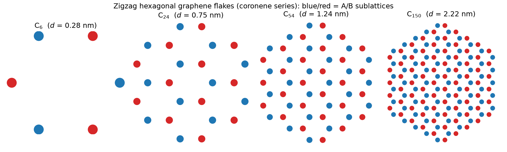
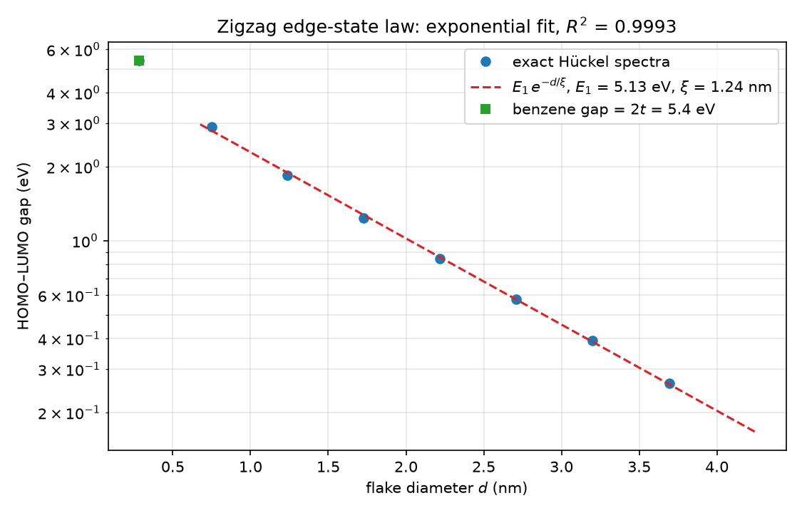
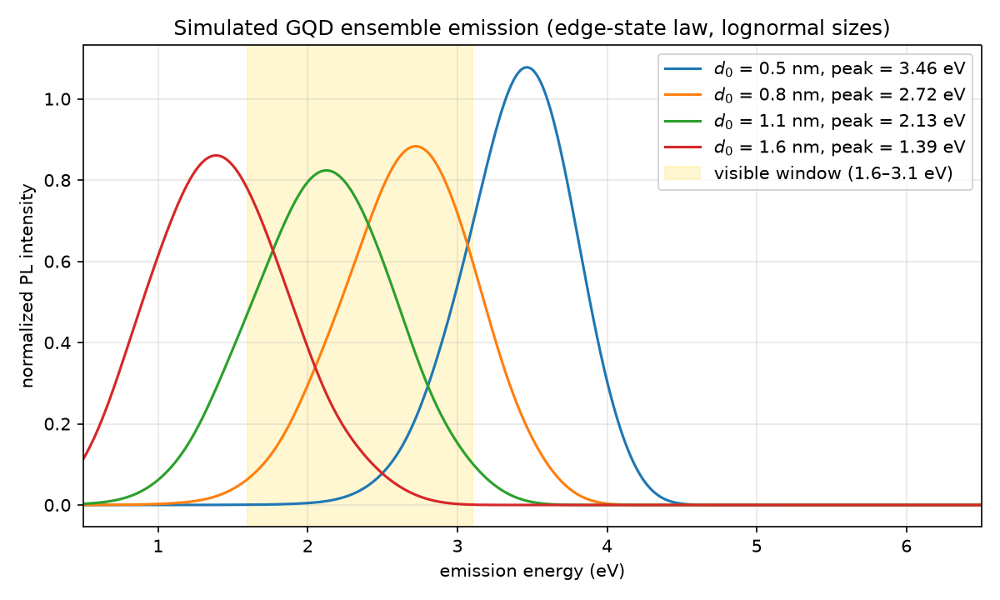

# qd-spectra — what graphene quantum dots should emit, from exact π-electron spectra

An atomistic + quantum-mechanical model of graphene quantum dots (GQDs) in
pure Python: every result below comes from **exact diagonalization of the
π-electron (Hückel/tight-binding) Hamiltonian** of atomically resolved
nanoflakes, validated against textbook limits and Lieb's theorem, and turned
into a size-distribution-averaged emission model built to be confronted with
measured photoluminescence spectra.

Built as the theory side of an optical-spectroscopy effort: plug in the
sample's size distribution (TEM/AFM/DLS) and get the predicted PL band.

## What the model reproduces (nothing hard-coded)

| Check | Exact theory | This code |
|---|---|---|
| Benzene π levels (the original 1930 Hückel result) | {±2t, ±t, ±t} | **exact to 10⁻¹⁰** ✓ |
| Benzene gap | 2t = 5.40 eV | 5.400 eV ✓ |
| Polyene chain gap, N sites | 4t·sin(π/(2(N+1))) | matches to 10⁻¹⁰ ✓ |
| Coronene series sizes | C₆, C₂₄, C₅₄, C₉₆ (= 6n²) | ✓ |
| Lieb's theorem (1989): S = \|N_A − N_B\| zero modes | C₁₃ phenalenyl → 1, C₂₂ triangulene → 2, C₃₃ → 3, C₄₆ → 4 | **1, 2, 3, 4** ✓ |
| Particle–hole symmetry of bipartite spectra | E ↔ −E | ✓ to 10⁻¹⁰ |

## The physics found (measured, then fitted)

**1. The zigzag gap law is exponential, not a power law.** The HOMO–LUMO gap
of zigzag hexagonal flakes falls as

```
gap(d) = E₁ · exp(−d/ξ),      E₁ = 5.13 eV,  ξ = 1.24 nm,  R² = 0.9993
```

across 0.75–3.7 nm (C₂₄ → C₃₈₄). E₁ sits right at the benzene gap 2t = 5.4 eV
(the molecular limit), and ξ is the edge-state hybridization length: the
frontier levels of zigzag flakes are edge-localized states, and their
splitting is the tunneling coupling between opposite edges. Fitting a power
law instead gives an "exponent" that drifts from 1.1 to 3.4 as the window
grows — the fingerprint of the exponential law, and a nice cautionary tale
about fitting the wrong model.

**2. Ensemble emission from the size law.** Averaging E(d) over a lognormal
size distribution (broadening 0.15 eV):

| Median diameter | Emission peak | Band |
|---|---|---|
| 0.5 nm | 3.46 eV (358 nm) | UV |
| 0.8 nm | 2.72 eV (456 nm) | visible (blue) |
| 1.1 nm | 2.13 eV (583 nm) | visible (yellow) |
| 1.6 nm | 1.39 eV (895 nm) | infrared |

**The testable statement for the lab**: π-confinement/edge-state physics puts
sub-1.5 nm dots in the visible and pushes bigger dots into the infrared.
Samples measured at several nm that still emit visible light are therefore
emitting from edge/functional states (sp³ defects, C=O groups) — a
quantitative discriminator between core-state and surface-state emission,
which is exactly the debate in the GQD literature and the kind of question
the group's PL data can answer.

| | |
|---|---|
|  | Atom-resolved flakes of the coronene series; blue/red = A/B sublattices. |
|  | Exact gaps and the exponential edge-state law. |
|  | Ensemble emission vs the visible window. |

## Using it with lab data

```python
from qdspectra.observables import fit_exponential_decay, hexagonal_gap_series
from qdspectra.spectra import model_pl_spectrum

rows = hexagonal_gap_series(max_n=8)[1:]
e1, xi, r2 = fit_exponential_decay([r["diameter_nm"] for r in rows],
                                   [r["gap_ev"] for r in rows])

# feed the sample's real size distribution (from TEM/AFM histograms):
grid, spectrum, peak = model_pl_spectrum(
    d0_nm=0.9, sigma_ln=0.3,       # <- median + width of measured sizes
    amplitude_ev=e1, xi_nm=xi,
    broaden_ev=0.15, stokes_ev=0.4,  # <- tune against the measured PL
)
```

## Model & honest limitations

- Single-parameter Hamiltonian: H = −t Σ⟨ij⟩ (nearest neighbours), t = 2.7 eV.
  No edge passivation (H), no electron–electron interaction (a Hubbard term
  would split the Lieb zero modes — spin physics), no exciton binding
  (optical gap < single-particle gap), no solvent/functionalization shifts.
- All of these shift the numbers by tenths of eV but do not change the
  structure of the size laws; each is a roadmap item.

## Repository layout

```
qd-spectra/
├── src/qdspectra/
│   ├── lattices.py       # coronene series, phenalenyl/triangulene, chains
│   ├── tightbinding.py   # Hückel Hamiltonian, exact spectra, zero modes
│   ├── observables.py    # size scans, exponential/power-law fits
│   └── spectra.py        # size-distribution-averaged PL line shapes
├── scripts/run_flakes.py     # survey + gap law + figures
├── scripts/run_emission.py   # ensemble PL vs the visible window
├── tests/                # 12 physics tests (pytest)
└── figures/, results/    # generated plots and CSV data (committed)
```

## Quickstart

```bash
python -m venv .venv
# Windows: .venv\Scripts\activate   |   Linux/macOS: source .venv/bin/activate
pip install -r requirements.txt
pip install -e .

pytest                         # 12 physics tests, ~3 s
python scripts/run_flakes.py
python scripts/run_emission.py
```

## Roadmap

- [ ] Hydrogen passivation of edges (on-site shifts) → how ξ and E₁ move
- [ ] Hubbard term on the Lieb flakes → spin splitting of zero modes
- [ ] Fit lab PL + TEM size distributions jointly (the actual paper)
- [ ] Exciton corrections (Coulomb term) for the optical gap

## References

- E. Hückel, *Grundzüge der Theorie ungesättigter Verbindungen* (1930) — benzene
- A. H. Castro Neto et al., *The electronic properties of graphene*, Rev. Mod. Phys. **81**, 109 (2009)
- E. H. Lieb, *Two theorems on the Hubbard model*, Phys. Rev. Lett. **62**, 1201 (1989)
- K. Nakada et al., *Edge state in graphene ribbons*, Phys. Rev. B **54**, 17954 (1996) — zigzag edge states
- Lab context: Cuadra, Ponce, Rudamas et al., MRS Advances **5**, 3345 (2020) — GQD PL and interlayer transitions

## License

MIT — see [LICENSE](LICENSE).
